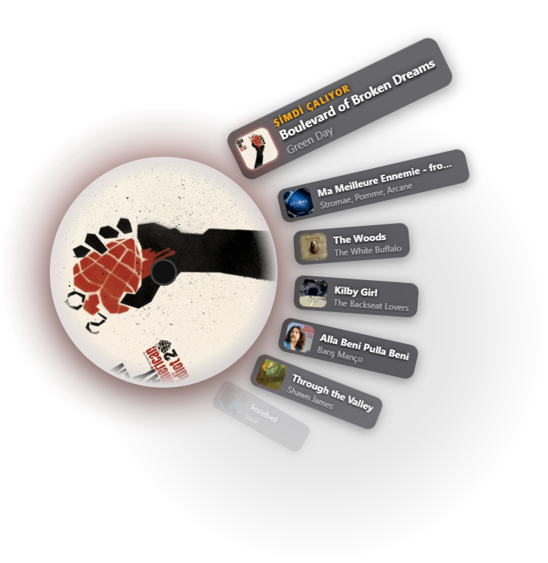
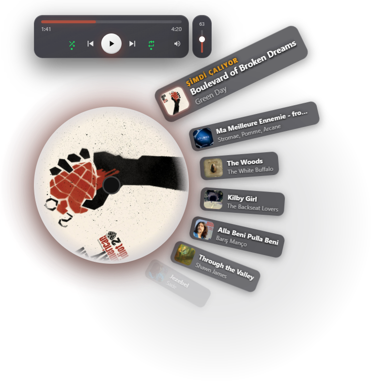
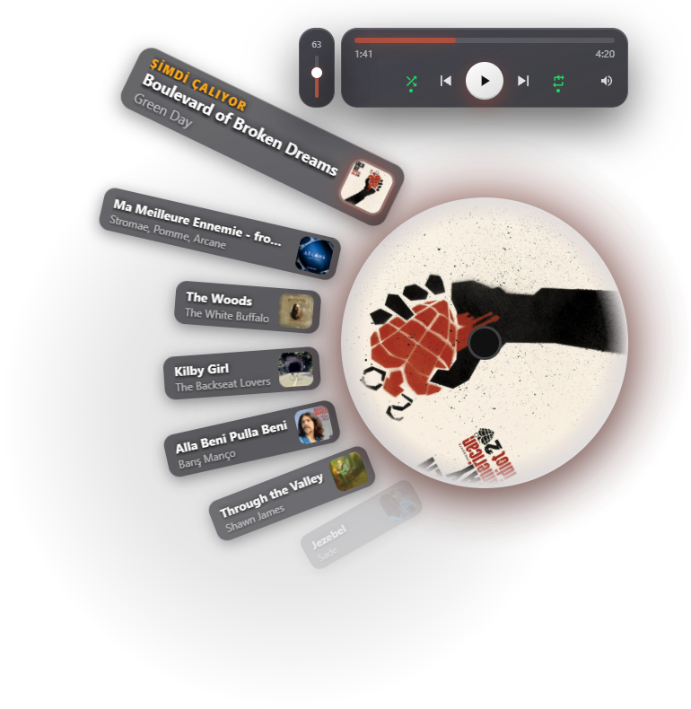

# 🎵 Spotify Visualizer Widget

A floating Spotify desktop widget for Windows, built with Electron: a spinning vinyl disc with your queue fanning out like flower petals, a hidden glass player, edge docking and a full-screen audio visualizer.

*Windows için Electron ile yapılmış, masaüstünde yüzen bir Spotify widget'ı.*

<p align="center">
  
  
</p>

## ✨ Özellikler

- **Dönen disk**: o an çalan şarkının kapağı, kapaktan alınan baskın renkte bir glow ile birlikte.
- **Yaprak liste**: sıradaki şarkılar diskin etrafına çiçek yaprağı gibi diziliyor. Tıklayınca o şarkıya geçiliyor, listeyi orta tuşla kaydırıyorsun.
- **Gizli oynatıcı**: seek bar, önceki/oynat/sonraki, karıştır, tekrar ve dikey ses barı.
- **Mini mod**: diske tıklayınca küçülüyor, tekrar tıklayınca büyüyor.
- **Her yere sürüklenebilir**: ekran dışına taşarsa yumuşakça içeri geri kayıyor.
- **Kenara dock**:
  - Disk sol ya da sağ kenara yarı gömülüyor; üstüne gelince dışarı çıkıyor.
  - Sağ kenarda düzen aynalanıyor, liste ve oynatıcı sola geçiyor.
  - Çoklu monitörde taşan kısım komşu ekrana sarkmıyor.
- **Tam ekran visualizer**:
  - Sistem sesini yakalayıp widget'ın bulunduğu ekranda arka plan olarak çiziyor.
  - Tıklamalar içinden geçiyor.
  - Diskten büyüyen bir daireyle açılıyor, açılırken diğer pencerelerin arkasında kalıyor.
  - Animasyonlar: Halka, Spektrum, Dalga, Galaksi. İstersen otomatik olarak sırayla değişiyorlar.
- **Tepsi ve ayarlar**: tepsi simgesi ve ayarlar penceresi. Disk boyutu, görünürlük, gölge, glow, kenar yumuşaklığı, dönüş, liste hızları, dock gecikmesi, visualizer modu ve daha fazlası ayarlanabiliyor. Ayarlar kalıcı.

<p align="center"></p>

## 🚀 Kurulum

1. [Spotify Developer Dashboard](https://developer.spotify.com/dashboard)'da bir uygulama oluştur.
   - Redirect URI: `http://127.0.0.1:8888/`
   - API: **Web API**
2. Repoyu klonla ve bağımlılıkları yükle:
   ```bash
   git clone https://github.com/FikretGezer/spotify-visualizer.git
   cd spotify-visualizer
   npm install
   ```
3. `config.example.js` dosyasını `config.js` olarak kopyala ve kendi Client ID'ni yaz.
4. Çalıştır:
   ```bash
   npm start
   ```
   İlk açılışta Spotify ile giriş yap (PKCE kullanılıyor, client secret gerekmiyor).

> Oynatma kontrolleri için **Spotify Premium** gerekiyor.

## 🖱️ Kullanım

| İşlem | Nasıl |
|---|---|
| Mini / tam mod | Diske tıkla |
| Taşıma | Diski sürükle |
| Oynatıcıyı aç | Diskin üstündeki ok |
| Listeyi kaydır | Orta tuşla sürükle |
| Göster / gizle | Tepsi simgesine tek tık |
| Ayarlar | Tepsi simgesine çift tık |
| Visualizer | Tepsi menüsü ya da ayarlar |

## 🛠️ Teknolojiler

Electron · Spotify Web API (PKCE) · Web Audio API · Canvas

## 📄 Lisans

[MIT](LICENSE)
