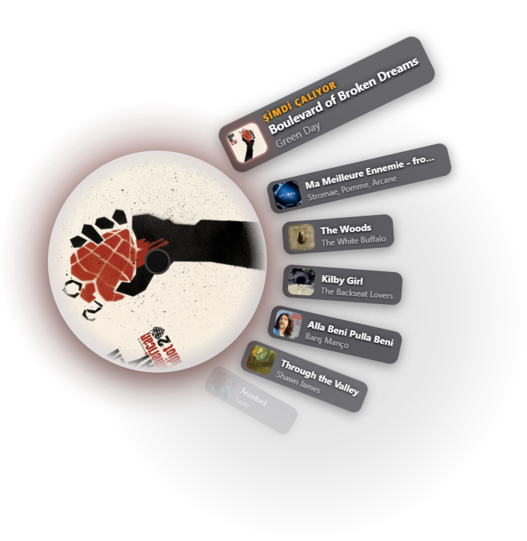
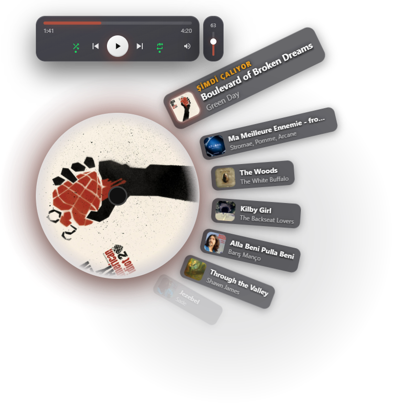
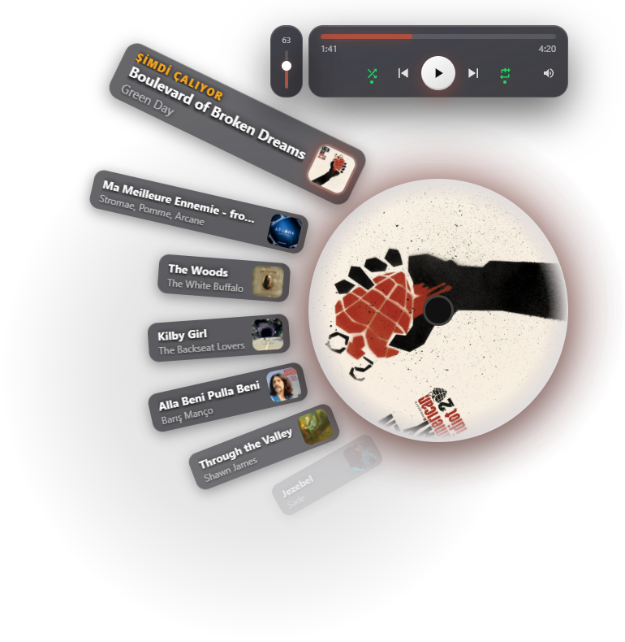

# 🎵 Spotify Visualizer Widget

[English](README.md) | **Türkçe**


<p align="center">
  
  
</p>

Masaüstünde yüzen bir Spotify widget'ı. Ortada çalan şarkının kapağıyla dönen bir plak var, sıradaki şarkılar çiçek yaprağı gibi etrafına diziliyor. İstersen ekran kenarına gömülüyor, istersen tüm ekranı müziğe göre oynayan bir visualizer'a çeviriyor. Boş alanlara yapılan tıklamalar alttaki pencerelere gidiyor, yani widget işini engellemiyor.

## Kurulum ve çalıştırma

1. Bilgisayarda **Node.js 18+** yüklü olmalı. [nodejs.org](https://nodejs.org) adresinden indirebilirsin.
2. [Spotify Developer Dashboard](https://developer.spotify.com/dashboard)'da bir uygulama oluştur:
   - **Redirect URI:** `http://127.0.0.1:8888/`
   - **API:** Web API
   - Oluşan **Client ID**'yi kopyala.
3. Repoyu indir ve paketleri kur:
   ```bash
   git clone https://github.com/FikretGezer/spotify-visualizer.git
   cd spotify-visualizer
   npm install
   ```
4. `config.example.js` dosyasını **`config.js`** adıyla kopyala ve içine Client ID'ni yaz. Bu dosya git'e gönderilmez.
5. Çalıştır:
   ```bash
   npm start
   ```
   İlk açılışta Spotify ile giriş yaparsın. Giriş PKCE ile yapılıyor, client secret gerekmez. Oturum hatırlanır.

> Oynatma kontrolleri (oynat/duraklat, atla, ses, karıştır) için **Spotify Premium** gerekir. Ücretsiz hesapta da çalan şarkı ve liste görünür.

## Kullanım

| İşlem | Nasıl |
|---|---|
| Mini / tam mod | Diske tıkla |
| Taşıma | Diski sürükle |
| Oynatıcıyı aç / kapat | Diskin üstündeki ok |
| Şarkıya geç | Listede şarkıya tıkla |
| Listeyi kaydır | Orta tuşla sürükle |
| Göster / gizle | Tepsi simgesine tek tık (yumuşak geçişle) |
| Ayarlar | Tepsi simgesine çift tık |
| Menü | Tepsi simgesine sağ tık |
| Visualizer | Diske sağ tıkla, ya da tepsi menüsü veya ayarlar |

## Özellikler

- **Dönen disk:**
  - Çalan şarkının kapağı plak gibi döner.
  - Etrafındaki glow kapağın baskın renginden alınır.
  - Hiçbir şey çalmıyorsa son çalan şarkının kapağı görünür.
- **Yaprak liste:**
  - Sıradaki şarkılar diskin etrafına çiçek yaprağı gibi eğik dizilir.
  - Kaydırdıktan sonra liste kendiliğinden başa döner. Gecikme ve hız ayarlanabilir.
- **Oynatıcı:**
  - Cam görünümlü, açılıp kapanabilen bir oynatıcı.
  - Seek bar, önceki / oynat / sonraki, karıştır, tekrar ve aynı stilde dikey ses barı içerir.
  - Disk ekranın üst kısmındaysa oynatıcı diskin altında açılır.
- **Akıllı konumlama:**
  - Widget ekran dışına taşarsa yumuşakça içeri kayar.
  - Kenarlara ve köşelere yaklaşınca yapışır.
- **Kenara dock:**
  - Diski sol ya da sağ kenara götürünce disk yarısı ekran dışında kalacak şekilde gömülür.
  - Diskin üstüne gelince widget dışarı çıkar, ayrılınca ayarlanan süre sonra geri döner.
  - Sağ tarafta düzen aynalanır: liste ve oynatıcı sola geçer. Geçiş sırasında liste bir tarafta söner, diğer tarafta belirir.
  - Çoklu monitörde taşan kısım komşu ekrana sarkmaz.
- **Tam ekran visualizer:**
  - Sistem sesini yakalar, widget'ın bulunduğu ekranın tamamında arka plan olarak çizer.
  - Tıklamalar içinden geçer.
  - Diskten büyüyen bir daireyle açılır, aynı şekilde kapanır.
  - Açılırken öndeki pencerelerin önüne geçmez, arkada kalır.
  - Animasyonlar: **Halka, Spektrum, Dalga, Galaksi.** İstersen belirli aralıklarla otomatik değişir.
  - İki arka plan: düz siyah ya da şeffaf. Şeffaf modda duvar kağıdın görünür, ortadaki gölge kenarlara doğru sıfıra iner (ayarlanabilir).
  - Varsa şarkı sözleri müzikle senkron görünür (LRCLIB). Ayarlardan kapatılabilir.
- **Ayarlar penceresi:** Tüm ayarlar `%APPDATA%\spotify-visualizer\settings.json` dosyasına otomatik kaydedilir.

<p align="center"></p>

## Ayarlar

| Bölüm | Neler ayarlanır |
|---|---|
| 📍 Konum | Her zaman üstte, Windows ile açılma, dock'tan geri dönme süresi, konumu sıfırla |
| 🎨 Görünüm | Görünürlük, disk boyutu, arka plan gölgesi, glow, kenar yumuşaklığı, dönme |
| 📜 Liste | Başa dönme gecikmesi, kaydırma yumuşaklığı, başa dönme hızı |
| 🌈 Visualizer | Animasyon seçimi, otomatik geçiş süresi |
| ⚡ Hızlı işlemler | Widget'ı göster/gizle, visualizer, çıkış yap, kapat |

## Dosyalar

| Dosya | Ne işe yarar |
|---|---|
| `main.js` | Electron ana süreç: pencereler, tepsi, sürükleme, dock, tıklama geçirme |
| `app.js` | Widget ve visualizer: Spotify API, liste, oynatıcı, ses yakalama, animasyonlar |
| `index.html` | Widget arayüzü ve stilleri |
| `settings.html` | Ayarlar penceresi |
| `preload.js` | Ana süreçle arayüz arasındaki köprü |
| `config.example.js` | Client ID şablonu (`config.js` olarak kopyala) |

## Sorun giderme

- **Giriş sayfası hata veriyor:** Dashboard'daki Redirect URI'nin tam olarak `http://127.0.0.1:8888/` olduğundan emin ol.
- **Kontroller çalışmıyor:** Premium hesap gerekir. Ayrıca Spotify'ın bir cihazda açık olması lazım.
- **Visualizer hareket etmiyor:** Bilgisayardan ses geldiğinden emin ol. Visualizer sistem sesini dinler.
- **Widget kayboldu:** Tepsi simgesine tıkla ya da ayarlardan *Konumu sıfırla*'ya bas.

## Lisans

[MIT](LICENSE) © FikretGezer
